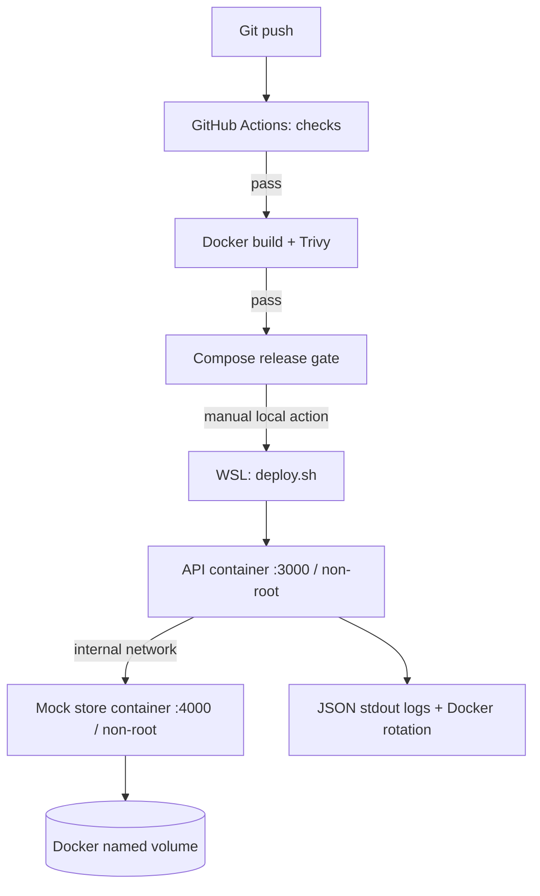

# Architecture

Liveness checks API process; readiness calls store health. No public port on store. Both containers drop Linux capabilities and forbid privilege escalation. Data volume persists across Compose restarts. Rollback changes image version, not stored data; schema migrations require independent rollback planning.
